# php-vio

A PHP extension that brings GPU rendering, audio, video recording, streaming, and input handling to PHP. Foundation layer for the [PHPolygon](https://github.com/phpolygon) game engine.

## Features

- **Multi-backend GPU rendering** — Direct3D 12, Direct3D 11, Metal, Vulkan, OpenGL 3.0–4.6; `vio_create('auto')` picks one per platform or ranks the adapters (`prefer`, `require`, optional calibration run)
- **2D batch renderer** — rects, rounded rects, circles, lines, sprites, text; z-sorted, transform and scissor stacks, the batch grows on demand
- **Text** — TrueType atlas filled on demand, HarfBuzz + SheenBidi shaping (Arabic, Thai, ligatures, bidirectional text), word wrap, vertical text
- **3D pipeline** — meshes, GLSL shaders, pipelines with blend / depth / stencil state, instancing, indirect draws, recorded draw sequences (`vio_bundle`)
- **Shader stages** — vertex, fragment, geometry, tessellation, mesh and task shaders, compute; multiview; HLSL and MSL overrides per stage
- **Render targets** — HDR, depth-only, MSAA, up to 8 colour attachments, cube and array targets, mip chains, readback in the target's own format
- **Textures** — 2D, 3D, arrays, cubemaps, BC and ASTC compression, KTX2, a bindless texture table
- **Compute** — storage buffers and storage images, dispatch inside the frame, vertex and fragment stages reading storage buffers
- **Ray tracing** — acceleration structures, inline ray queries, ray tracing pipelines, opacity micromaps (Direct3D 12, Vulkan; ray queries also on Metal)
- **Upscaling** — portable spatial and temporal upscaler (`vio_upscale`), AMD FSR 3.1 and, through a plugin, NVIDIA DLSS (`vio_upscaler_*`; Direct3D 12 and Vulkan)
- **Shader toolchain** — GLSL to SPIR-V (glslang), reflection and translation to HLSL / MSL / GLSL (SPIRV-Cross), on-disk shader cache
- **Desktop applications** — several windows, child and modal windows, menu bar and context menus, file dialogs, message boxes, notifications, tray icon, taskbar progress, file drop, IME composition, cursors, screen-reader support (AccessKit), an event loop that waits instead of polling
- **Input** — keyboard, mouse, gamepads, touch, clipboard; injection, virtual gamepads and record / replay for tests
- **Audio** — playback via miniaudio (MP3, WAV, FLAC, Ogg Vorbis, Ogg Opus), Opus / Vorbis encoding and decoding, 3D audio with live pitch / pan, distance attenuation models, Doppler, cones, 2D / 3D switch per sound, offline rendering
- **Video recording** — H.264 via FFmpeg with the platform's hardware encoders (NVENC, AMF, QSV, Media Foundation, VideoToolbox) and libx264 as the fallback
- **Network streaming** — RTMP and SRT via FFmpeg
- **Headless mode** — offscreen rendering, pixel readback, screenshots and image comparison for visual regression tests
- **Plugin system** — output / input / filter plugins and a versioned C ABI for upscaler plugins
- **Cross-platform** — Windows, macOS, Linux (X11 and Wayland) with native window layers; GLFW is optional

Which of these a context has depends on the backend, the GPU and the libraries the extension was built with. Ask at run time: `vio_supports_feature($ctx, VIO_FEATURE_*)`, `vio_feature_info()`, `vio_backend_info()` and, for the window system, `vio_platform_info()`.

## Gallery

Every image below is rendered headless by [`examples/gallery.php`](examples/gallery.php)
(`php -d extension=vio examples/gallery.php [backend]`); the PNGs live in `docs/gallery/`.
They double as a smoke test of each feature path on a real backend.

| | |
|---|---|
| 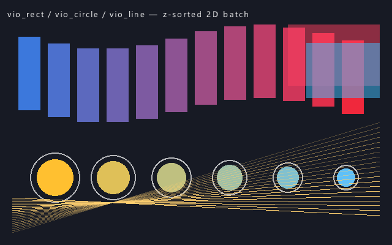 `vio_rect` / `vio_circle` / `vio_line`, z-sorted batch | 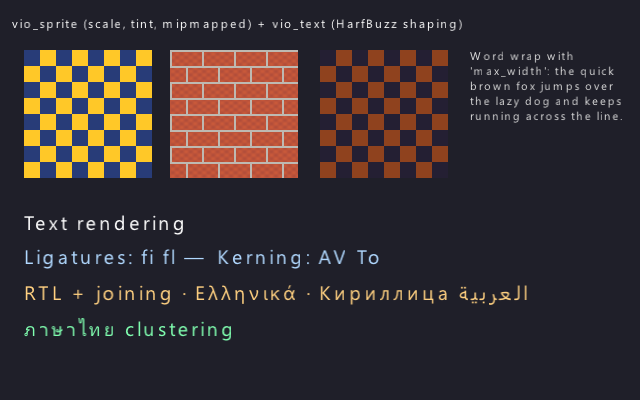 `vio_sprite` + `vio_text` (HarfBuzz shaping, RTL, Thai, word wrap) |
| 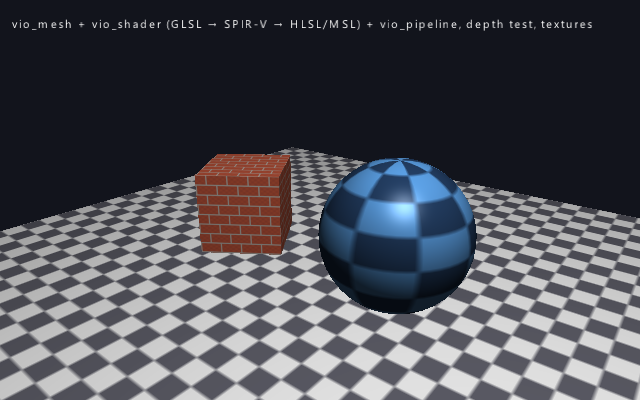 `vio_mesh` / `vio_shader` / `vio_pipeline`, GLSL → SPIR-V → HLSL/MSL | 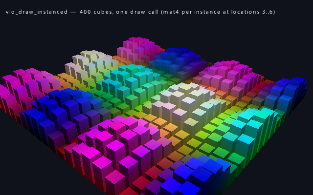 `vio_draw_instanced`, 400 cubes in one draw |
| 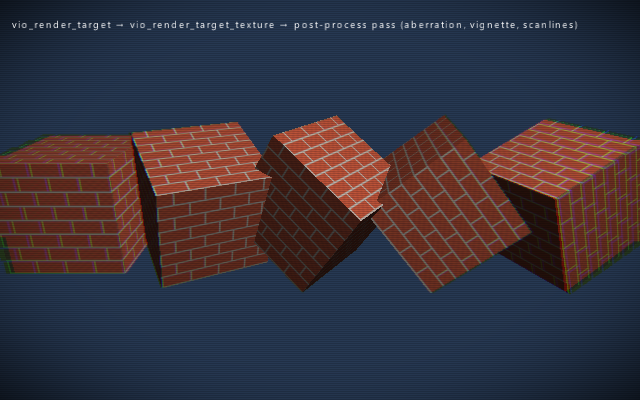 `vio_render_target` → post-process pass | 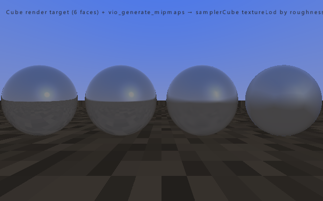 Cube render target + `vio_generate_mipmaps` → `textureLod` by roughness |
| 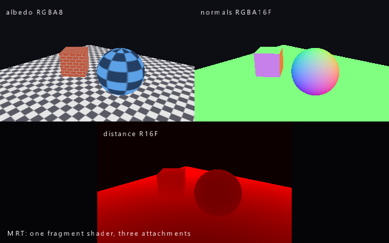 Multiple render targets (RGBA8 / RGBA16F / R16F) | 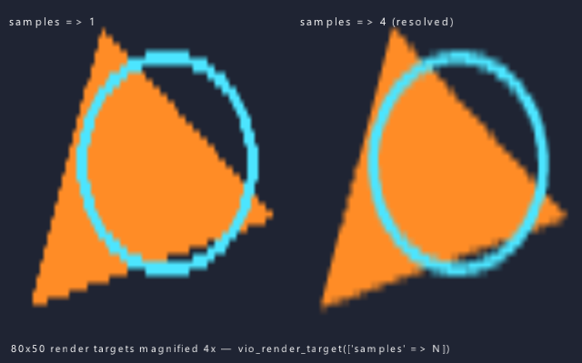 `['samples' => 4]` render target, resolved |
| 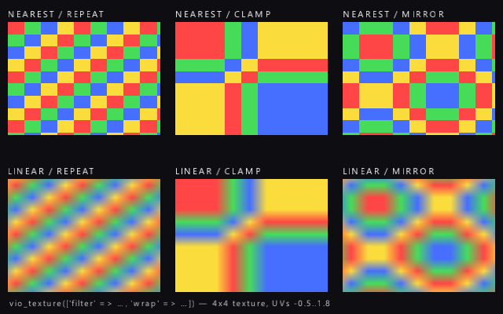 `filter` × `wrap` sampler grid | 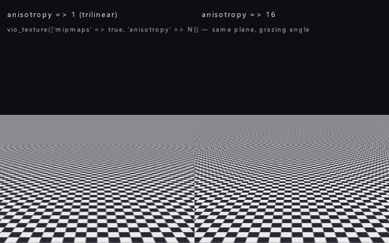 `['anisotropy' => 16]` vs. trilinear |
| 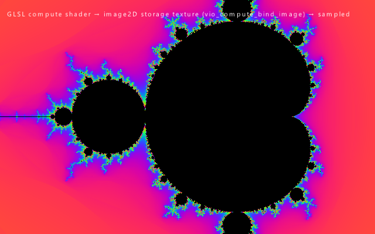 Compute shader → `image2D` storage texture | 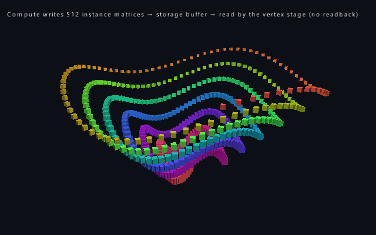 Compute writes instance matrices, the vertex stage reads them (no readback) |
| 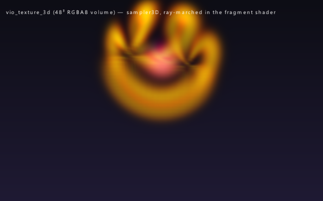 `vio_texture_3d` ray-marched via `sampler3D` | 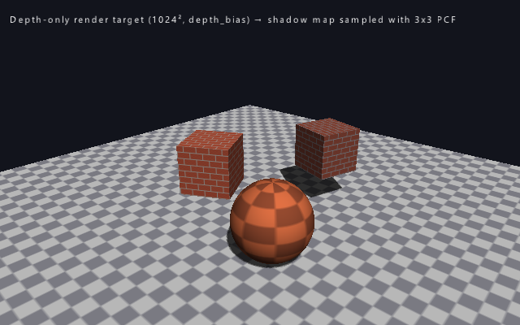 Depth-only render target → PCF shadows |
| 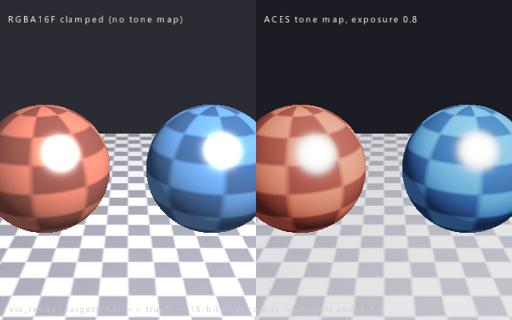 `['hdr' => true]` RGBA16F target + ACES | 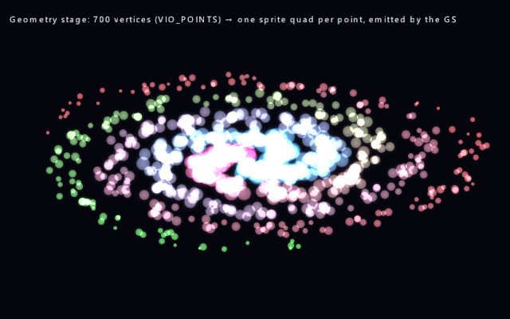 `vio_shader(['geometry' => …])`: one vertex per point, the GS emits sprite quads |
| 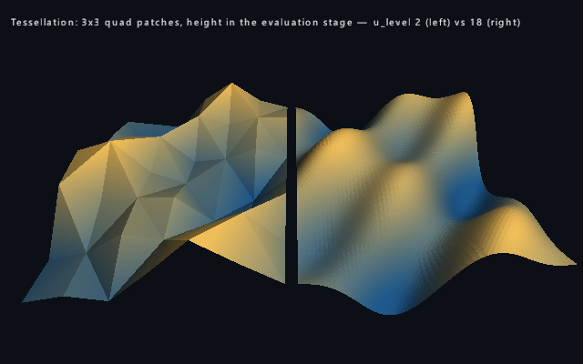 `tess_control` + `tess_eval`, `VIO_PATCHES`: quad patches displaced in the evaluation stage, level 2 vs 18 | 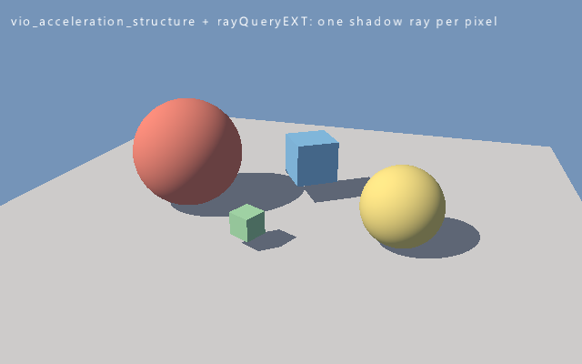 `vio_acceleration_structure` + `rayQueryEXT`: one shadow ray per pixel |
| 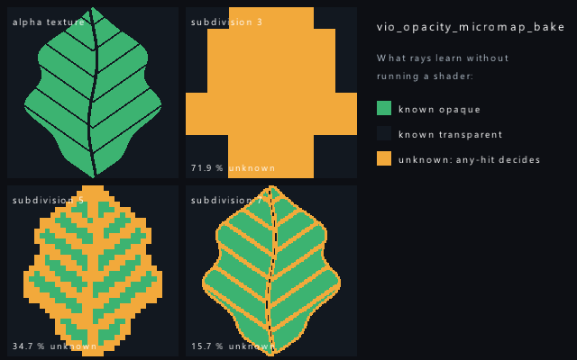 `vio_opacity_micromap_bake`: what rays learn from an alpha texture without running a shader | 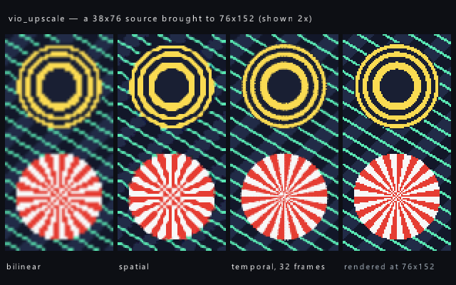 `vio_upscale`: half-resolution source, bilinear vs. spatial vs. temporal (32 jittered frames) vs. rendered at full size |
| 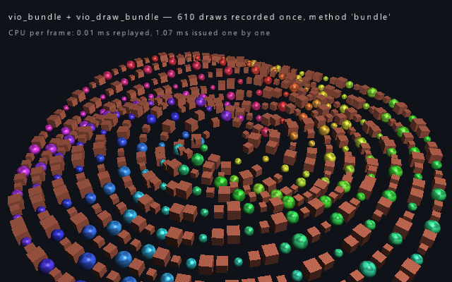 `vio_bundle` + `vio_draw_bundle`: 610 draws recorded once, replayed per frame | 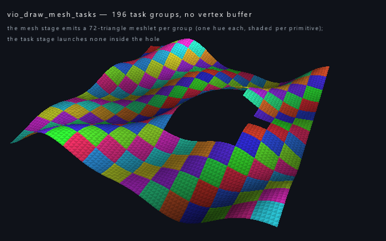 `vio_shader(['task' => …, 'mesh' => …])` + `vio_draw_mesh_tasks`: meshlets generated on the GPU, the task stage culls a hole |
| 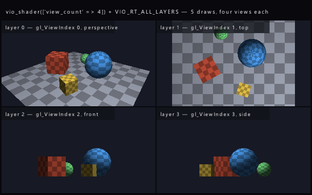 `['view_count' => 4]` + `VIO_RT_ALL_LAYERS`: every draw lands in four layers, one camera per `gl_ViewIndex` | 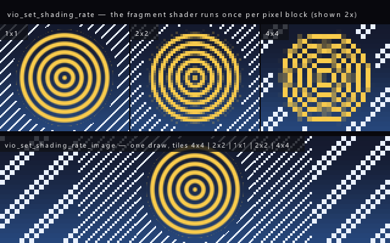 `vio_set_shading_rate` 1x1 / 2x2 / 4x4 and `vio_set_shading_rate_image` (shown 2x) |
| 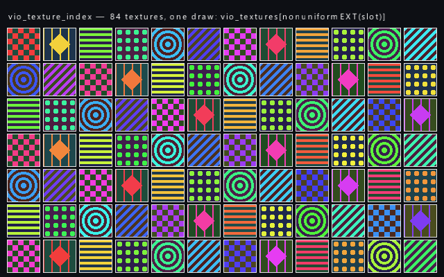 `vio_texture_index`: 84 textures in one draw through `vio_textures[]` | 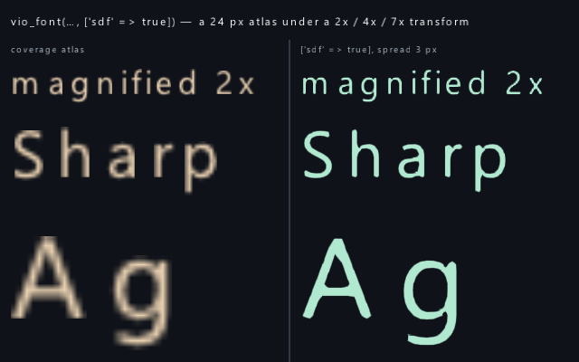 `vio_font(…, ['sdf' => true])`: a 24 px atlas magnified, coverage vs. distance field |

`php examples/gallery.php [backend] [outdir] [scene,…]` renders all scenes or a comma-separated selection. A scene whose feature the
backend does not report is skipped: ray queries, mesh shaders and bindless textures need Direct3D 12, Vulkan or Metal with a GPU and driver
that support them, variable rate shading Direct3D 12 or Vulkan, opacity micromaps Vulkan or Direct3D 12 with the Agility SDK
(`VIO_D3D12_AGILITY_SDK`) and DXC (`VIO_DXC_DIR`).
The gallery covers rendering only: the native upscalers (FSR 3.1, DLSS), the remaining ray-tracing features, work graphs, audio, video
and the desktop-application APIs (windows, menus, dialogs, tray) have no scene yet.

## Requirements

- PHP >= 8.5

All native libraries are optional — the extension compiles and runs without them, features are simply unavailable at runtime:

| Library | Feature | Build Flag |
|---------|---------|------------|
| [GLFW](https://www.glfw.org/) 3.4 | Windowing, input, gamepad where no native window layer is built (optional on Windows, macOS, X11, Wayland) | `--with-glfw` |
| Xlib + XRandR | X11 window layer (Linux) | `--with-x11` (on by default when found) |
| wayland-client, wayland-cursor, xkbcommon, wayland-scanner, wayland-protocols | Wayland window layer (Linux) | `--with-wayland` (on by default when found) |
| [glslang](https://github.com/KhronosGroup/glslang) | GLSL to SPIR-V compilation | `--with-glslang` |
| [SPIRV-Cross](https://github.com/KhronosGroup/SPIRV-Cross) | Shader reflection & translation (required for shaders on Direct3D, Metal and Vulkan) | `--with-spirv-cross` |
| [Vulkan SDK](https://vulkan.lunarg.com/) | Vulkan backend (Vulkan 1.3, or 1.2 with dynamic rendering and synchronization2) | `--with-vulkan` |
| [FFmpeg](https://ffmpeg.org/) | Video recording & streaming | `--with-ffmpeg` |
| [HarfBuzz](https://harfbuzz.github.io/) | Text shaping (Arabic, Thai, ligatures, vertical text); `VIO_HAS_SHAPING` | `--with-harfbuzz` |
| [AccessKit](https://github.com/AccessKit/accesskit-c) (C release package) | Screen readers (`vio_a11y_update`) | `--with-accesskit=DIR` |
| Metal (macOS framework) | Metal backend | `--with-metal` |
| Direct3D 11 (Windows SDK) | Direct3D 11 backend | `--with-d3d11` (Windows, on by default) |
| Direct3D 12 (Windows SDK) | Direct3D 12 backend | `--with-d3d12` (Windows, on by default) |
| AMD FidelityFX API headers (vendored) | FSR 3.1 upscaler; the FidelityFX DLLs are loaded at run time, not linked | `--with-ffx` (on by default on Windows) |

Vendored and always built: GLAD, stb, Vulkan Memory Allocator, miniaudio, SheenBidi, libopus / libogg / opusfile / libvorbis.

## Installation

### Via PIE (PHP Installer for Extensions)

```bash
pie install phpolygon/php-vio
```

### Pre-built Binaries

Download platform-specific binaries from the [Releases](https://github.com/phpolygon/php-vio/releases) page. Available for:

- Linux x86_64 / ARM64
- macOS x86_64 (Intel) / ARM64 (Apple Silicon)
- Windows x64

### From Source (macOS)

```bash
brew install php glfw glslang spirv-cross ffmpeg harfbuzz vulkan-loader vulkan-headers molten-vk

phpize
./configure --enable-vio --with-glfw --with-glslang --with-spirv-cross \
  --with-vulkan --with-ffmpeg --with-metal --with-harfbuzz
make -j$(sysctl -n hw.ncpu)
sudo make install
```

Use SPIRV-Cross `vulkan-sdk-1.4.363.0` or newer: older versions lay out arrays of structs in a uniform block with the wrong stride on Metal.

### From Source (Linux)

```bash
# Ubuntu/Debian
sudo apt install php-dev libglfw3-dev glslang-dev libvulkan-dev \
  libavcodec-dev libavformat-dev libavutil-dev libswscale-dev \
  spirv-cross libspirv-cross-c-shared-dev libharfbuzz-dev libx11-dev libxrandr-dev \
  libwayland-dev wayland-protocols libxkbcommon-dev

phpize
./configure --enable-vio --with-glfw --with-glslang --with-spirv-cross \
  --with-vulkan --with-ffmpeg --with-harfbuzz
make -j$(nproc)
sudo make install
```

### Windows

On Windows, no build toolchain is needed — PHP extensions are distributed as pre-compiled DLLs. Download the matching DLL from the [Releases](https://github.com/phpolygon/php-vio/releases) page (match your PHP version and thread-safety mode), then:

1. Copy `php_vio.dll` into your PHP `ext\` directory
2. Add `extension=vio` to your `php.ini`
3. Restart PHP / your web server

To build it yourself, use the PHP SDK with the Visual Studio 2022 build tools; `config.w32` takes `--with-glfw`, `--with-vulkan`, `--with-glslang`, `--with-spirv-cross`, `--with-ffmpeg`, `--with-harfbuzz` and `--with-accesskit` with the directory of each dependency.

All backends use conditional compilation (`#ifdef HAVE_*`), so builds without certain dependencies compile fine — those features are simply unavailable at runtime.

## Quick Start

```php
<?php

// Open a window on the platform's preferred backend
$ctx = vio_create("auto", [
    "width"  => 800,
    "height" => 600,
    "title"  => "Hello VIO",
]);

while (!vio_should_close($ctx)) {
    vio_begin($ctx);
    vio_clear($ctx, 0.1, 0.1, 0.1);

    // 2D drawing; colours are 0xAARRGGBB
    vio_rect($ctx, 50, 50, 200, 100, ["color" => 0xFFFF0000]);
    vio_circle($ctx, 400, 300, 60, ["color" => 0xFF00FF00]);
    vio_draw_2d($ctx);

    vio_end($ctx);
    vio_poll_events($ctx);
}

vio_close($ctx);
vio_destroy($ctx);
```

More scripts are in [`examples/`](examples): a window, a triangle, input, a custom shader, 2D drawing, the gallery renderer and three benchmarks (`bench_backends.php` compares the backends, see [Performance](#performance)).

## API Overview

273 functions and 20 classes. A selection by category:

| Category | Functions |
|----------|-----------|
| Context | `vio_create`, `vio_begin`, `vio_end`, `vio_clear`, `vio_close`, `vio_destroy`, `vio_poll_events`, `vio_wait_events`, `vio_wake` |
| Window | `vio_window_size`, `vio_framebuffer_size`, `vio_set_title`, `vio_set_window_size`, `vio_set_fullscreen`, `vio_set_borderless`, `vio_monitors`, `vio_on_resize`, `vio_on_close`, `vio_on_focus`, `vio_on_refresh` |
| Desktop | `vio_window`, `vio_menu_bar`, `vio_popup_menu`, `vio_file_dialog`, `vio_message_box`, `vio_notify`, `vio_tray`, `vio_set_progress`, `vio_on_drop`, `vio_set_cursor`, `vio_set_window_icon`, `vio_open_url`, `vio_a11y_update`, `vio_platform_info` |
| Input | `vio_key_pressed`, `vio_mouse_position`, `vio_mouse_button`, `vio_on_key`, `vio_on_char`, `vio_on_preedit`, `vio_gamepads`, `vio_touch_count`, `vio_clipboard_get`, `vio_inject_key`, `vio_input_replay` |
| 2D | `vio_rect`, `vio_rounded_rect`, `vio_circle`, `vio_line`, `vio_sprite`, `vio_text`, `vio_push_transform`, `vio_push_scissor`, `vio_draw_2d` |
| 3D | `vio_mesh`, `vio_shader`, `vio_pipeline`, `vio_bind_pipeline`, `vio_set_uniform`, `vio_draw`, `vio_draw_instanced`, `vio_draw_indirect`, `vio_submit_batch`, `vio_bundle`, `vio_draw_mesh_tasks` |
| Render targets | `vio_render_target`, `vio_bind_render_target`, `vio_render_target_texture`, `vio_read_render_target`, `vio_generate_mipmaps`, `vio_viewports` |
| Textures | `vio_texture`, `vio_texture_3d`, `vio_texture_ktx2`, `vio_cubemap`, `vio_bind_texture`, `vio_texture_update`, `vio_texture_index`, `vio_texture_load_async` |
| Fonts | `vio_font`, `vio_text`, `vio_text_measure`, `vio_font_has_glyph`, `vio_font_load_async` |
| Buffers & compute | `vio_uniform_buffer`, `vio_storage_buffer`, `vio_update_buffer`, `vio_compute_pipeline`, `vio_compute_dispatch`, `vio_storage_buffer_read` |
| Ray tracing | `vio_acceleration_structure`, `vio_rt_pipeline`, `vio_trace_rays`, `vio_opacity_micromap_bake` |
| Upscaling | `vio_upscale`, `vio_upscale_jitter`, `vio_upscaler_create`, `vio_upscaler_dispatch`, `vio_upscaler_prepare` |
| Audio | `vio_audio_load`, `vio_audio_play`, `vio_audio_pause`, `vio_audio_stop`, `vio_audio_pitch`, `vio_audio_pan`, `vio_audio_spatial`, `vio_audio_attenuation`, `vio_audio_velocity`, `vio_audio_doppler`, `vio_audio_listener`, `vio_audio_encode`, `vio_audio_decode`, `vio_audio_render` |
| Recording | `vio_recorder`, `vio_recorder_capture`, `vio_recorder_info`, `vio_recorder_stop`, `vio_video_info`, `vio_video_frame` |
| Streaming | `vio_stream`, `vio_stream_push`, `vio_stream_stop` |
| Headless | `vio_read_pixels`, `vio_save_screenshot`, `vio_compare_images`, `vio_save_diff_image` |
| Shaders | `vio_shader_reflect`, `vio_shader_cache_stats`, shader compilation via glslang |
| Introspection | `vio_backends`, `vio_backend_name`, `vio_backend_info`, `vio_adapters`, `vio_rank_backends`, `vio_supports_feature`, `vio_feature_info`, `vio_gpu_info`, `vio_gpu_frame_time` |
| Plugins | `vio_plugins`, `vio_plugin_info` |

Every signature with its options is in [vio.stub.php](vio.stub.php); guides and the API reference are on the [documentation site](https://phpolygon.github.io/php-vio-docs/).

## Backends

| Backend | Status | Platforms |
|---------|--------|-----------|
| Direct3D 12 | Stable | Windows only |
| Direct3D 11 | Stable | Windows only |
| Metal | Stable | macOS only |
| OpenGL 3.0–4.6 | Stable | macOS (up to 4.1), Linux, Windows |
| Vulkan | Stable | Linux, Windows, macOS (MoltenVK, opt-in) |
| Null | Stable | All (for unit testing) |

Backend auto-selection is platform-specific:

- **Windows:** Direct3D 12 → Direct3D 11 → Vulkan → OpenGL
- **macOS:** Metal → OpenGL  (Vulkan via MoltenVK is opt-in, not auto)
- **Linux:** Vulkan → OpenGL

`Null` is never auto-selected; request it explicitly with `vio_create("null")` for headless tests. Override auto-selection per call (`vio_create("d3d11")`) or globally via the `vio.default_backend` INI setting. With `vio_create('auto', ['prefer' => 'performance' | 'quality' | 'compat', 'require' => [VIO_FEATURE_*, …]])` the choice follows a ranking of the installed adapters instead (`vio_rank_backends()`, `vio_adapters()`); `vio_backend_info($ctx)['selected_by']` tells how the backend was chosen.

Features differ per backend and GPU — for example variable rate shading, ray tracing pipelines and the native upscalers exist on Direct3D 12 and Vulkan only, and geometry shaders run through compute emulation on Metal. Check `vio_supports_feature()` before relying on one.

## Performance

`examples/bench_backends.php` draws the same five scenes on every backend the build can open: 1280x720, headless, vsync off, 600 frames after 60 warm-up frames. The Mac tables give the frame time from `vio_begin()` to the return of `vio_end()` in microseconds, as median / 99th percentile. Measured with php-vio 2.44.1 and PHP 8.5.

**Apple M5 (macOS 27.2)**

| Scene | Metal | OpenGL 4.1 |
|---|---:|---:|
| 2D: 500 rects | 66 / 188 | 142 / 258 |
| 2D: 200 rects + 200 rounded rects + 50 texts | 185 / 211 | 284 / 325 |
| 2D: 1000 rects + 100 texts | 277 / 296 | 468 / 593 |
| 3D: 1000 draws, 2 uniforms each | 231 / 249 | 616 / 675 |
| 3D: 10 000 instances, 1 draw | 130 / 146 | 113 / 189 |

**MacBook Pro, Intel Core i9-9880H (macOS 26.7)** — Metal on either GPU (`VIO_METAL_ADAPTER`); OpenGL runs on the integrated GPU.

| Scene | Metal, Radeon Pro 5500M | Metal, UHD 630 | OpenGL 4.1, UHD 630 |
|---|---:|---:|---:|
| 2D: 500 rects | 158 / 286 | 279 / 439 | 441 / 1145 |
| 2D: 200 rects + 200 rounded rects + 50 texts | 542 / 706 | 574 / 749 | 878 / 1542 |
| 2D: 1000 rects + 100 texts | 836 / 1165 | 937 / 1262 | 666 / 854 |
| 3D: 1000 draws, 2 uniforms each | 574 / 800 | 703 / 877 | 1194 / 1496 |
| 3D: 10 000 instances, 1 draw | 170 / 273 | 743 / 842 | 1290 / 1429 |

**Windows 11, NVIDIA GeForce RTX 2080** — here the table gives the time to issue the frame (`vio_begin()` to `vio_draw_2d()`), median in microseconds. Headless Vulkan and OpenGL contexts copy every presented frame back to the host, which makes their `vio_end()` take longer than on Direct3D, so the frame time would not compare the backends.

| Scene | Direct3D 12 | Direct3D 11 | Vulkan 1.3 | OpenGL 4.6 |
|---|---:|---:|---:|---:|
| 2D: 500 rects | 139 | 126 | 180 | 672 |
| 2D: 200 rects + 200 rounded rects + 50 texts | 491 | 453 | 669 | 941 |
| 2D: 1000 rects + 100 texts | 634 | 601 | 825 | 986 |
| 3D: 1000 draws, 2 uniforms each | 831 | 434 | 1146 | 1028 |
| 3D: 10 000 instances, 1 draw | 44 | 123 | 122 | 92 |
On both Macs Metal is the faster backend in most scenes and has the steadier frame times; OpenGL is ahead in two cells (10 000 instances on the M5 by the median, the text-heavy 2D scene on the Intel Mac). On the RTX 2080 Direct3D 11 issues a frame fastest in four of the five scenes and Direct3D 12 when one draw covers 10 000 instances; Vulkan and OpenGL spend more CPU time per frame. These numbers are CPU-side times of small scenes, each from one run on a desktop machine: they compare the cost of issuing draws, not GPU throughput. Run the script on your own machine before choosing a backend:

```bash
php -d extension=vio examples/bench_backends.php            # every backend
php -d extension=vio examples/bench_backends.php metal,opengl 600 --json=bench.json
```
## Testing

```bash
NO_INTERACTION=1 TEST_PHP_EXECUTABLE=$(which php) \
  php run-tests.php -d extension=$PWD/modules/vio.so tests/
```

`run-tests.php` is placed in the build directory by `phpize`.

294 PHPT tests, grouped by topic under `tests/` (`core/`, `backends/`, `render3d/`, `render2d/`, `input/`, `window/`, `media/`) — headless rendering with pixel verification, 2D/3D pipelines, shaders, compute, ray tracing, upscaling, audio, input, windows and desktop APIs, and the per-backend capability matrix. `run-tests.php` recurses into the folders; pass a single folder to run one area.

## License

[MIT](LICENSE)
